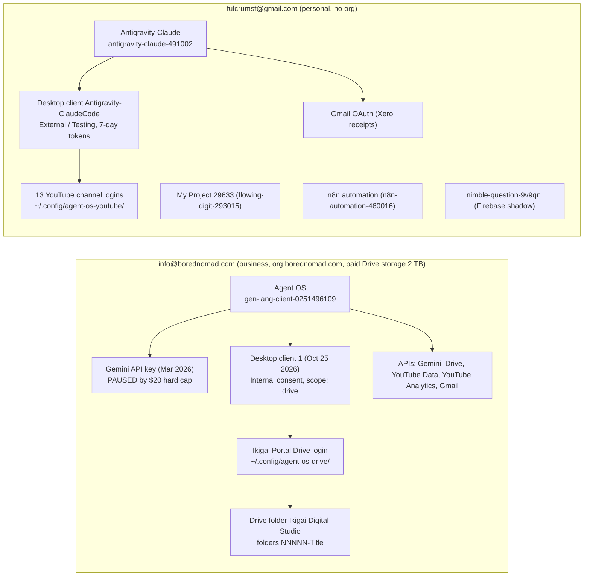

# Google Cloud Map (verified live 2026-10-25)

Two separate Google identities, kept apart on purpose. Never move YouTube to the business account (Tony was demonetized on the BoredNomad site and keeps the channels off it to protect AdSense).

## Business account: info@borednomad.com
| Project | ID | Holds | Status |
|---|---|---|---|
| **Agent OS** (renamed 2026-10-25 from "Blotato - Antigravity") | `gen-lang-client-0251496109` | Gemini API key; Desktop OAuth client for Drive; Drive, YouTube Data, YouTube Analytics, Gmail APIs enabled; consent screen **Internal** (no 7-day expiry) | Keep. The single home for everything Agent-OS. |

- Billing account `01AF23-B42882-ADD61A`. Budget "Blotato-Antigravity $20 Hard Cap Monthly" on Gemini API: **spend cap enforced since Oct 11 2026 (~$20.33 / $20.00)**, so Gemini calls from this project return 403 until the cap resets at the start of next month (or Tony lifts it). Check any tool that depends on this key.
- Shut down 2026-10-25 by Tony (30-day restore window, then permanent): Upkeeply App (`gen-lang-client-0368503082`; will get a fresh project if restarted), Gemini API (`gen-lang-client-0553978373`; only backed the retired character-sheet test app in `~/Documents/Docker/ai-character-sheet-generator`), Make (`fine-program-454108-r9`; Make.com automations retired), BoredNomad WooCommerce Website (`theta-eon-450804-c2`; site gone).

## Personal account: fulcrumsf@gmail.com
| Project | ID | Holds | Status |
|---|---|---|---|
| **Antigravity-Claude** | `antigravity-claude-491002` | YouTube Data + Analytics API; Desktop client `Antigravity-ClaudeCode`; External/Testing consent (tokens expire every 7 days); Gmail OAuth | Keep. Home of all YouTube logins. |
| My Project 29633 | `flowing-digit-293015` | dead/unused (Oct 6 check) | Delete candidate, Tony's call |
| n8n automation | `n8n-automation-460016` | dead/unused (Oct 6 check) | Delete candidate, Tony's call |
| nimble-question-9v9qn | no id shown | Auto-provisioned Firebase/AI-Studio shadow project behind an old key | Leave alone |

## Rules of thumb
- Anything Agent-OS or Claude Code related goes in **Agent OS** (business account). New app = new project, so deleting an app later is clean.
- YouTube stays in the personal project. YouTube re-login: `001_Architecture/Scripts/youtube_analytics_auth.py <label>`; Drive re-login: `001_Architecture/Scripts/google_drive_auth.py`.
- API keys live in `~/.env-secrets`, never in notes. The `~/.env-secrets` Gemini key ending `ggWM` returned 403 on 2026-10-25, consistent with the paused cap.
